

<a href="#"><picture><source media="(prefers-color-scheme: light)" srcset="assets/header-light.svg"></picture></a> 
<a href="#"><picture><source media="(prefers-color-scheme: light)" srcset="assets/about-light.svg"></picture></a> 
<a href="#"><picture><source media="(prefers-color-scheme: light)" srcset="assets/title-projects-light.svg"></picture></a> 
<a href="https://peniko.vercel.app"><picture><source media="(prefers-color-scheme: light)" srcset="assets/card-peniko-light.svg"></picture></a> 
<a href="https://github.com/SoulSej10/spliteven-app"><picture><source media="(prefers-color-scheme: light)" srcset="assets/card-spliteven-light.svg"></picture></a><a href="https://github.com/SoulSej10/StoreEmpire"><picture><source media="(prefers-color-scheme: light)" srcset="assets/card-storeempire-light.svg"></picture></a> 
<a href="https://github.com/SoulSej10/The-Garden"><picture><source media="(prefers-color-scheme: light)" srcset="assets/card-garden-light.svg"></picture></a><a href="https://github.com/SoulSej10/Dearest"><picture><source media="(prefers-color-scheme: light)" srcset="assets/card-dearest-light.svg"></picture></a> 
<a href="https://github.com/SoulSej10/SMP-Post-Scheduler"><picture><source media="(prefers-color-scheme: light)" srcset="assets/card-smp-light.svg"></picture></a><a href="https://github.com/SoulSej10/My-Eportfolio"><picture><source media="(prefers-color-scheme: light)" srcset="assets/card-portfolio-light.svg"></picture></a> 
<a href="#"><picture><source media="(prefers-color-scheme: light)" srcset="assets/title-stack-light.svg"></picture></a> 
<a href="#"><picture><source media="(prefers-color-scheme: light)" srcset="assets/stack-light.svg"></picture></a> 
<a href="#"><picture><source media="(prefers-color-scheme: light)" srcset="assets/title-stats-light.svg"></picture></a> 
<a href="#"><picture><source media="(prefers-color-scheme: light)" srcset="https://github-readme-stats.vercel.app/api?username=SoulSej10&show_icons=true&hide_border=true&card_width=500&border_radius=0&bg_color=E3F2FF&title_color=0B2545&text_color=1F3B5C&icon_color=0B7A55&ring_color=0B7A55&custom_title=Sej%27s%20GitHub%20stats"></picture></a><a href="#"><picture><source media="(prefers-color-scheme: light)" srcset="https://streak-stats.demolab.com?user=SoulSej10&hide_border=true&card_width=500&card_height=195&border_radius=0&background=E3F2FF&stroke=9CC9EE&ring=0B7A55&fire=B7700A&currStreakNum=0B2545&sideNums=0B2545&currStreakLabel=0B7A55&sideLabels=1F3B5C&dates=4A6A8A"></picture></a> 
<a href="#"><picture><source media="(prefers-color-scheme: light)" srcset="assets/title-contact-light.svg"></picture></a> 
<a href="https://www.linkedin.com/in/jess-anthony-tahil-46a442197/"><picture><source media="(prefers-color-scheme: light)" srcset="assets/tile-linkedin-light.svg"></picture></a><a href="https://x.com/JessTahil2002"><picture><source media="(prefers-color-scheme: light)" srcset="assets/tile-x-light.svg"></picture></a><a href="https://my-eportfolio-two.vercel.app/"><picture><source media="(prefers-color-scheme: light)" srcset="assets/tile-portfolio-light.svg"></picture></a><a href="https://github.com/SoulSej10?tab=repositories"><picture><source media="(prefers-color-scheme: light)" srcset="assets/tile-repos-light.svg"></picture></a> 
<a href="#"><picture><source media="(prefers-color-scheme: light)" srcset="assets/footer-light.svg"></picture></a>

